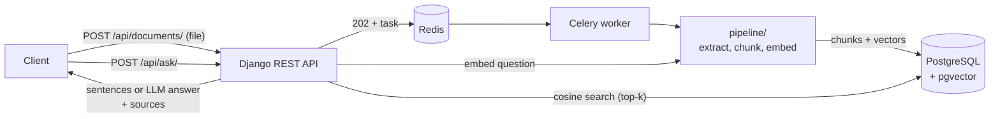

# Document Q&A API


Upload PDF or text documents, ask questions in plain language, and get back the passages that answer them, each with its **document and page number**. Built with Django REST Framework, PostgreSQL + **pgvector**, and Celery/Redis.

The retrieval step is measured, not assumed: `eval/` contains sample documents, 24 questions with known answers, and a script that reports Hit@k and MRR. The numbers and their limits are listed [below](#how-well-does-it-work).

## Features

- Token authentication; every user only ever sees their own documents
- Asynchronous indexing: upload returns `202`, a Celery worker extracts, chunks, embeds and stores the text
- Page-aware chunking (sentence-aligned, overlapping, never crossing a page), so every answer can cite a page
- Vector search with pgvector (cosine distance, HNSW index)
- Two answer modes: **extractive** (default; returns sentences from your documents, no external service) and **LLM** (optional; Claude writes an answer from the retrieved passages and falls back to extractive on failure)
- Two embedding backends: a dependency-free **hash** embedder (default) and a multilingual **sentence-transformers** model
- Rate limits on uploads and questions, upload validation (type, size, PDF header)
- OpenAPI docs (Swagger UI), CI on a real PostgreSQL with pgvector, a retrieval-quality regression test

## Architecture



`pipeline/` has no Django imports, so the same code is used by the web app, the tests and the evaluation script.

## Quick start

Requires Docker with Compose.

```bash
docker compose up --build
```

API docs: http://localhost:8000/api/docs/

```bash
# register and get a token
curl -X POST localhost:8000/api/auth/register/ -H 'Content-Type: application/json' \
  -d '{"username":"alice","password":"a-long-unusual-passphrase-42"}'
TOKEN=$(curl -s -X POST localhost:8000/api/auth/token/ -H 'Content-Type: application/json' \
  -d '{"username":"alice","password":"a-long-unusual-passphrase-42"}' \
  | python3 -c "import sys,json; print(json.load(sys.stdin)['token'])")

# upload a sample document and wait until its status is "ready"
curl -X POST localhost:8000/api/documents/ -H "Authorization: Token $TOKEN" \
  -F file=@eval/docs/nordlicht_handbook.pdf
curl localhost:8000/api/documents/1/ -H "Authorization: Token $TOKEN"

# ask
curl -X POST localhost:8000/api/ask/ -H "Authorization: Token $TOKEN" \
  -H 'Content-Type: application/json' \
  -d '{"question":"How many days per week can I work from home once probation is over?"}'
```

Result for that question, shortened to two sources. It was produced with the same pipeline code the API uses, on an in-memory index, so scores can differ slightly from pgvector's float rounding. The first sentence carries the document heading (see [limitations](#limitations)):

```json
{
  "mode": "extractive",
  "answer": "Nordlicht Energy - Employee Handbook Working hours and remote work Core working hours at Nordlicht Energy are 10:00 to 15:00 on weekdays. Employees may work remotely up to three days per week after completing the six-month probation period.",
  "sources": [
    {"document_title": "nordlicht_handbook", "page": 1, "score": 0.1967, "text": "Nordlicht Energy - Employee Handbook Working hours and remote work ..."},
    {"document_title": "nordlicht_handbook", "page": 2, "score": 0.1296, "text": "Nordlicht Energy - Employee Handbook Leave policy ..."}
  ]
}
```

## API overview

| Method | Path | Description |
|---|---|---|
| POST | `/api/auth/register/` | Create a user |
| POST | `/api/auth/token/` | Get an auth token |
| POST | `/api/documents/` | Upload PDF/TXT/MD (multipart `file`, optional `title`); returns `202` |
| GET | `/api/documents/` | Your documents with `status`: `pending`, `processing`, `ready`, `failed` |
| GET | `/api/documents/{id}/` | One document (`error` explains a failure) |
| DELETE | `/api/documents/{id}/` | Delete a document, its chunks and its file |
| POST | `/api/ask/` | `{"question", "top_k"?, "document_ids"?}` → answer + cited sources |

## How well does it work

Run it yourself: `python eval/run_eval.py`.

The set is 3 invented documents (9 pages) and 24 questions written by the author. A retrieved chunk counts as correct only if it comes from the right page **and** contains the answer phrase. "Random" is the expected score of a ranking that ignores the question.

Default settings (hash embedder, 400-character chunks, 18 chunks in total):

| Metric | Result | Random ranking |
|---|---|---|
| Hit@1 | 0.62 | 0.06 |
| Hit@3 | 0.75 | 0.17 |
| Hit@5 | 0.79 | 0.28 |
| MRR | 0.68 | n/a |

Chunk size changes the picture, and the corpus is small enough to mislead:

| Chunk size / overlap | Chunks | Hit@1 | Hit@5 | Random Hit@5 | MRR |
|---|---|---|---|---|---|
| 250 / 50 | 30 | 0.58 | 0.79 | 0.17 | 0.69 |
| **400 / 80 (default)** | 18 | 0.62 | 0.79 | 0.28 | 0.68 |
| 800 / 150 | 9 | 0.58 | 0.92 | 0.56 | 0.71 |

The 800-character row has the highest Hit@5 only because 9 chunks means the top 5 already cover more than half of the corpus. The default was chosen before this table was produced and was not tuned on these questions.

What the numbers do not say:

- **The hash embedder matches words, not meaning.** Four of the 24 questions never reach the top 10; two of them are synonym cases ("doctor's note" vs "medical certificate", "guarantee" vs "warranty"). A neural embedder should help there, but no result for it is recorded in this repository. To measure it: `pip install -r requirements-ml.txt && EMBEDDING_BACKEND=sentence-transformers python eval/run_eval.py`.
- **It cannot tell that a question is unrelated.** Correct top results scored 0.08 to 0.35; off-topic questions ("best recipe for chocolate cake") scored up to 0.24. No `RETRIEVAL_MIN_SCORE` separates them, so the `no_results` answer only triggers on near-zero matches. Tune the threshold on your own documents if you switch to a neural model.
- **24 questions from one author on 9 pages** is a smoke test, not a benchmark. Treat differences of a few points as noise.
- Taking the two best sentences of the top-ranked chunk, the answer contained the key phrase for 15 of 24 questions (13 of 24 with one sentence). This includes retrieval misses.

## Tests

```bash
docker compose run --rm web pytest
```

| File | What it checks |
|---|---|
| `tests/pipeline/` | extraction, chunking (size limit, overlap, page boundaries, nothing lost), embeddings, extractive answers, and a **retrieval quality gate** that fails CI if Hit@1/Hit@5/MRR drop clearly below the values above. No database needed. |
| `tests/test_documents_api.py` | auth, upload and background indexing, validation, failed documents, per-user isolation, delete |
| `tests/test_retrieval.py` | search against real pgvector: ranking, page, document filter, user isolation, score threshold |
| `tests/test_qa_api.py` | answers with sources, LLM mode and its fallback, validation, rate limiting |
| `tests/test_migrations.py` | migrations match the models; the `vector` extension and HNSW index exist |

## Configuration

Environment variables (see `.env.example`):

| Variable | Default | Meaning |
|---|---|---|
| `EMBEDDING_BACKEND` | `hash` | `hash` or `sentence-transformers` (needs `requirements-ml.txt`) |
| `EMBEDDING_MODEL` | `intfloat/multilingual-e5-small` | Must produce 384 dimensions (the column size) |
| `ANSWER_BACKEND` | `extractive` | `anthropic` enables LLM answers (needs `requirements-llm.txt` and `ANTHROPIC_API_KEY`) |
| `ANSWER_MODEL` | `claude-sonnet-5-5` | Model used in LLM mode |
| `CHUNK_MAX_CHARS` / `CHUNK_OVERLAP_CHARS` | `400` / `80` | Chunking; re-upload documents after changing |
| `RETRIEVAL_MIN_SCORE` | `0.05` | Minimum cosine similarity for a hit |
| `MAX_UPLOAD_MB` | `10` | Upload size limit |

Changing the embedding backend or model requires re-uploading documents: vectors from different models are not comparable.

## Project layout

```
config/            settings, URLs, Celery app
pipeline/          extract.py, chunk.py, embed.py, answer.py, index.py (no Django)
apps/accounts/     registration and token endpoints
apps/documents/    Document and Chunk models (pgvector), upload API, Celery task
apps/retrieval/    vector search
apps/qa/           /api/ask/, extractive and LLM answers
eval/              sample PDFs, questions, run_eval.py
tests/             pytest suite
```

## Limitations

- No OCR: scanned PDFs fail with a clear error. Encrypted PDFs are not supported.
- Headings without a final period are glued to the next sentence, so extractive answers can start with a section title (visible in the example above). Layout-aware extraction would fix this.
- Tables and multi-column layouts are extracted as plain text in reading order, which can mix columns.
- Documents are untrusted input. In LLM mode the prompt tells the model to ignore instructions inside sources, which reduces but does not eliminate prompt-injection risk.
- Development setup: `runserver` and a Redis broker without authentication. Use gunicorn, secrets and TLS for anything public.

## Ideas for next steps

- Hybrid search (pgvector plus PostgreSQL full-text search) to catch exact terms the embedder misses
- A re-ranking step on the top 20 hits
- Streaming answers; a small front end that shows the cited page
